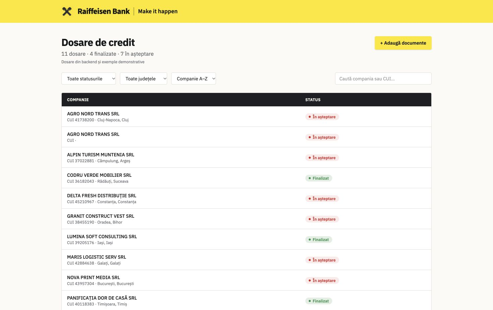
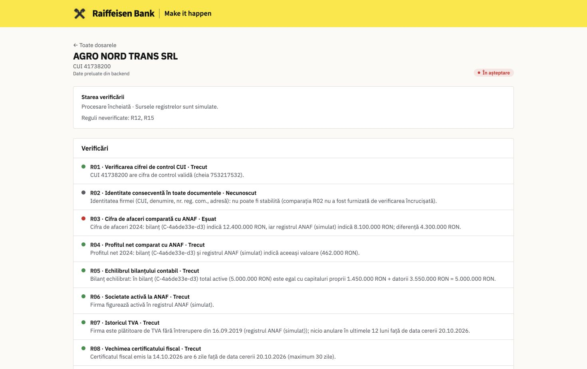
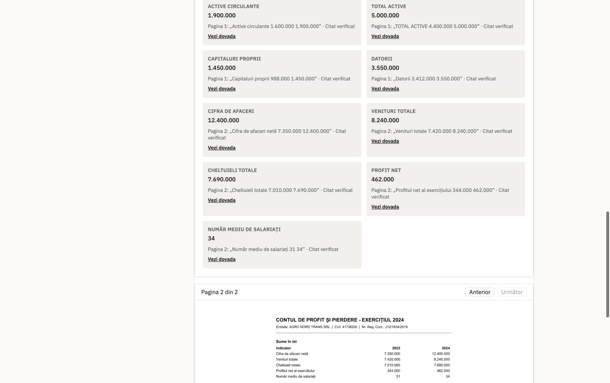

# Dosar Verificat

**Evidence-backed SME credit-file verification — a six-person hackathon prototype.**

Built for **Raiffeisen Bank’s challenge at the NEXXT AI Summit hackathon**, Dosar Verificat
explores how an agent-assisted workflow could prepare a credit file before an analyst opens it:
classify the documents, extract values with evidence, compare them with registry records, and
bring exceptions to the analyst’s attention.

We worked as a team of six within a 24-hour challenge. We did not reach the final, and the
application is still incomplete. This repository shares what we built, what remains unfinished,
and what we learned about scope, integration, and teamwork.

> **Prototype status:** the local demo processes synthetic PDF credit files and uses simulated
> registry responses. Autonomous Maker/Checker agents, live sanctions screening, and durable
> audit logging are part of the intended architecture, not completed features.

## The problem

An SME credit file can contain a financing application, a balance sheet, a tax certificate,
a trade-register certificate, and a beneficial-owner declaration. Checking that these documents
are complete and consistent takes time, especially when each value must be traced to its source.

Our goal is to give the analyst an evidence-backed review, with routine checks handled in code
and discrepancies presented for human judgment. The prototype does not make lending decisions.

## Intended workflow and current implementation

| Stage | Intended design | What this prototype currently does |
| --- | --- | --- |
| **1. Document intake** | Classify PDFs and extract each value with its page and exact quote. | Processes uploaded PDFs, classifies supported document types, and extracts fields with page references. Code checks quotes against the source text and drops unsupported extractions. A matching quote establishes traceability; it does not guarantee the document or interpretation is correct. |
| **2. Maker agent** | Independently choose which sources to consult, including ANAF company status and financials, and EU/UN sanctions lists. | A deterministic orchestrator calls fixture-based registry tools. Autonomous tool selection and live official integrations are not implemented. |
| **3. Rules engine** | Evaluate 15 bank rules in code, with pass, fail, or unknown results and evidence. | Includes an R01–R15 catalog and deterministic rules. R02, R10, and R11 lack integrated comparison producers and remain unknown; R12 and R15 are deferred. |
| **4. Checker agent** | Independently re-check every red flag and escalate disagreements. | Independent Maker/Checker agents are not implemented; the checker verdict remains `n/a`. Existing escalation handles unavailable or failed verification stages, not agent disagreement. |
| **5. Analyst review and audit** | Show exceptions, let the analyst decide, and log every decision. | The UI shows findings and PDF evidence. A decision API records decisions in memory and requires a second, different approver for red findings. Durable decision/audit storage and a complete analyst decision interface remain unfinished; the audit endpoint serves fixture data. |

## Demo: 12.4M RON in the PDF, 8.1M RON in the registry

The `DEMO-02` synthetic credit file demonstrates the implemented flow:

1. Upload its five PDFs through the dashboard.
2. The backend classifies and processes the documents, extracting values with source quotes.
3. The balance sheet reports **12,400,000 RON** in turnover; the simulated ANAF record reports
   **8,100,000 RON** for the same year.
4. **R03 fails**, explaining the **4,300,000 RON difference** with evidence references.
5. **R13 also flags a simulated enforcement case.** The final case outcome is `exceptions`.
6. Open **Bilanț contabil**, find **Cifra de afaceri**, and select **Vezi dovada** to jump to page 2.

All bundled companies, people, financial records, and PDF documents are synthetic. Registry
responses are fixtures, not official live checks. The UI also labels bundled demo cases when
showing them alongside backend cases or when the backend is unavailable.

## Screenshots

### Credit-file dashboard



### Verification results and exceptions



### Extracted values linked to the original PDF



## Run locally

Requirements: Python 3.11+ and a current Node.js version compatible with Vite 8 (Node 24 was
used for validation), plus npm and Git.

### 1. Clone and start the backend

```bash
git clone https://github.com/andreibarbuceanu/dosar-verificat.git
cd dosar-verificat
python3 -m venv .venv
source .venv/bin/activate
python -m pip install -r requirements.txt
LLM_BACKEND=replay python -m uvicorn app.api.main:app --reload --port 8000
```

On Windows, activate with `.venv\Scripts\activate` and set `LLM_BACKEND=replay` using your
shell’s environment-variable syntax before starting Uvicorn.

Replay is the default extraction backend. It uses recorded responses and a deterministic
fallback for unrecorded prompts; the demo does not require an external model API key.

### 2. Start the frontend in another terminal

From the repository root:

```bash
cd web
npm ci
VITE_API_BASE_URL=http://localhost:8000 npm run dev
```

Open **http://localhost:8080**, or the URL printed by Vite. The interface is in Romanian.
Backend API documentation is at **http://localhost:8000/docs**.

Choose **Adaugă documente**, upload all five PDFs from `pdfs/DEMO-02/`, and wait for processing.
Use **Anterior**, **Următor**, and **Vezi dovada** to inspect the supporting pages.

Stop each server with `Ctrl+C`. Cases and decisions are stored in memory, so upload the PDFs
again after restarting the backend.

## Technology and architecture

- **Frontend:** React, TypeScript, TanStack Router/Start, Tailwind CSS, Vite.
- **Backend:** Python, FastAPI, Pydantic, PyMuPDF.
- **Extraction:** a shared structured-output LLM interface with replay, CLI, and API backends;
  source-quote verification in code.
- **Verification:** fixture-based registry tools, deterministic comparisons and rule evaluation.
- **Testing:** pytest, Vitest, Testing Library, and an offline intake-evaluation harness.

```text
PDF upload → FastAPI → PDF processing → Classification → Evidence-backed extraction
                                                          ↓
React dashboard ← Case + findings ← Outcome ← Rules ← Registry fixtures + comparisons
       ↓
Source quote → Supporting PDF page
```

## Checks

Backend, with the virtual environment activated:

```bash
python -m pytest -q
python selftest/run_selftest.py
```

Frontend:

```bash
cd web
npm test
npx tsc --noEmit
npm run build
```

The intake self-test intentionally feeds broken fixtures to the evaluator. Individual `FAIL`
results are expected for those fixtures; the harness should finish with `SELFTEST PASSED`.

## What remains unfinished

- Autonomous Maker and independent Checker agents, including disagreement handling.
- Live ANAF and other official-registry integrations; EU/UN sanctions screening.
- Integrated comparisons for R02, R10, and R11.
- R12 sanctions and R15 injection-to-rule integration. Suspicious-text detection exists in
  document processing, but it is not a completed R15 verification rule.
- Durable storage for cases, decisions, and audit events.
- A complete analyst decision workflow, authentication, background processing, and deployment
  hardening. Uploaded PDF bytes use local storage and `/run` is synchronous.
- The independent Sprint 2 end-to-end evaluation harness planned for the project.

## Team and contributors

Built together by our six-person team:

- [@andreibarbuceanu](https://github.com/andreibarbuceanu)
- [@MihaiB3](https://github.com/MihaiB3)
- [@teodoratirca13](https://github.com/teodoratirca13)
- [@Steefyy](https://github.com/Steefyy)
- [@rdenis03](https://github.com/rdenis03)
- [@boxeorudoru-lab](https://github.com/boxeorudoru-lab)

## What we learned

We planned too many features for 24 hours. Several were complex to implement, some remained
unfinished, and integrating separate modules late left less time to polish the complete flow.

For the next event, we would:

1. **Pick three or four core features** and cut the rest early.
2. **Get one complete flow working first**, then expand it.
3. **Integrate the team’s modules hours earlier**, with shared contracts and frequent checks.

Working as a team of six challenged us to divide responsibilities, communicate blockers, ask
for help, and learn from different approaches. We are proud of the work we brought together,
and we want to build on it with better preparation and coordination.

Thank you to **Raiffeisen’s mentors** for their feedback and to the **NEXXT AI Summit**
organizers for the experience.

## Repository guide

| Path | Contents |
| --- | --- |
| `app/` | API, document pipeline, extraction, registry tools, comparisons, rules, and outcomes |
| `web/` | Frontend application |
| `pdfs/` | Synthetic demo and evaluation documents |
| `fixtures/` | Recorded extraction responses, simulated registries, and API examples |
| `tests/` | Backend test suites |
| `selftest/`, `check_intake.py` | Offline intake-evaluator checks |
| `companies.json`, `expected/` | Synthetic ground truth for generation/evaluation; the backend pipeline does not use these to decide findings |

See [synthetic data and intake evaluation](docs/SYNTHETIC_DATA.md),
[full integration report](docs/FULL_INTEGRATION_REPORT.md),
[frontend archive integration](docs/ZIP_FRONTEND_INTEGRATION.md), and
[branch consolidation](docs/BRANCH_CONSOLIDATION.md) for details and historical validation notes.

The consolidated default branch is **`final/unified-project`**, which retains the history of
the original team branches.
